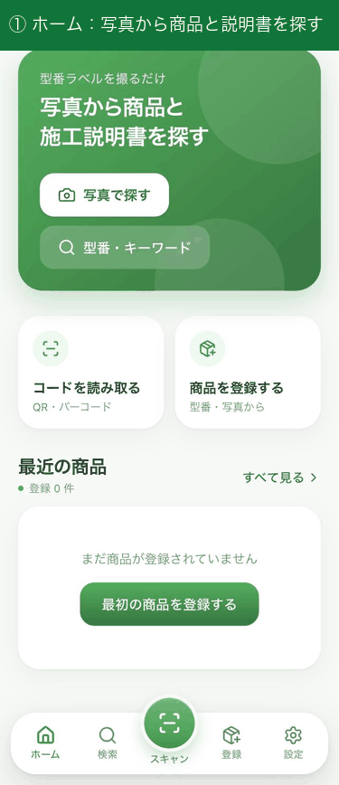
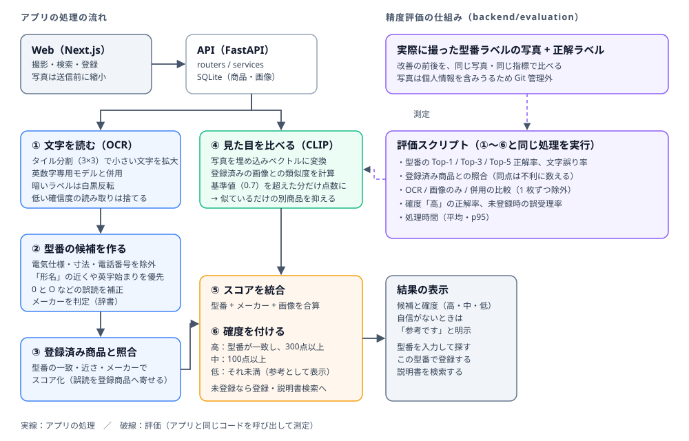

# 施工ナビ

[](https://github.com/Onoyanma/sekou-navi/actions/workflows/ci.yml)

施工現場向けの **商品検索・登録支援アプリ** です。
商品写真や型番ラベル・バーコードから型番やメーカー・カテゴリを推定し、施工説明書の検索や商品管理を効率化します。

<p align="center">
  
</p>

<p align="center"><sub>画面のスクリーンショットをつないだものです（ホーム → 撮影 → 登録済みの商品 → 未登録の商品）。実際の画面は <a href="assets/screenshots">assets/screenshots</a> にあります。</sub></p>

## 開発の背景

施工現場では、設備の型番確認や施工説明書の検索に時間がかかるという課題があります。
本アプリは OCR・画像検索・バーコード読み取りを組み合わせ、現場での検索・登録作業を短時間で行えるようにすることを目的に開発しています。

## 成果：実写真で測って改善した

「それっぽく動く」で終わらせず、**実際に撮影した型番ラベルの写真で精度を測り、数字を見ながら改善**しました。評価の仕組みは [backend/evaluation/](backend/evaluation/README.md) にあり、誰でも再現できます。

| 指標（実写真 14 枚） | 改善前 | 改善後 |
|---|---|---|
| 型番の Top-1 正解率（OCR のみ） | 7.1% | **35.7%** |
| 商品の Top-1 正解率（OCR + 登録済み商品の照合） | - | 64.3% |
| 商品の Top-1 / Top-3 正解率（OCR + 画像検索を併用） | - | **78.6% / 92.9%** |
| 未登録の商品を別の商品と取り違えた割合 | - | 0% |
| 1 枚あたりの処理時間（Apple Silicon、GPU 利用） | 8.1 秒（タイル分割で精度を上げた時点では 11.4 秒に増加） | **4.1 秒** |

### どう進めたか

1. **測る仕組みを先に作った**：型番ラベルの写真と正解ラベルから、Top-k 正解率・文字誤り率・処理時間を出すスクリプトを作成。以降の改善はすべて同じデータで前後比較。
2. **原因を分解した**：OCR の生テキストを見て、「電気仕様（`980W`、`50/60Hz`）が型番より高得点になる」「前処理が文字を壊している」「0 と O の取り違え」「そもそも読めていない」に切り分け。
3. **効く順に直した**：前処理の廃止、画像のタイル分割と英数字専用モデル、低確信度の読み取りの除外、型番候補の採点の見直し、家電メーカーの追加。
4. **OCR が読めない写真を画像検索で救えるか検証した**：登録済み商品との照合、CLIP との併用を同じ指標で比較。
5. **処理時間を測って詰めた**：内訳を計測し、5 通りの案を精度と一緒に比べて、精度を落とさない GPU 利用を採用。

### 失敗と、そこから学んだこと

- **既存の前処理（白黒化・コントラスト強調・2 倍拡大）が逆効果だった**：最初の測定は Top-1 が 0%。「やった気になっていた処理」は測らないと分からない、と学んだ。
- **画像検索を足したら、かえって悪化した写真があった**：型番ラベルの写真は別商品どうしでも CLIP の類似度が高く（同じ商品 0.74〜0.87、別商品 0.56〜0.90）、似ているだけの商品が型番の一致を押しのけた。類似度の基準値を導入して解消（0.6〜0.8 で同じ結果になる範囲から 0.7 を採用）。
- **最初の集計は甘かった**：同点の商品が登録順の偶然で 1 位になり、商品 Top-1 が 71.4% と出ていた。同点は不利に数える方式に直して 64.3% に。
- **自分で付けた正解ラベルが間違っていた**：小さくて読みにくいラベルを `SL-0138K` と読んでいたが、撮り直したら `SL-013BK` だった。正解データの質が評価の質を決める。
- **本番でも起きていた不具合を、評価の過程で見つけた**：OCR の一時ファイルが消されずに溜まっていた（修正済み）。

### 限界（正直に）

- 評価データは **14 枚・9 種類の商品**と少なく、同じ商品の取り直しを含みます。数字は「小規模な検証」の結果です。
- 登録済み商品は 21 件で、実際の運用規模より少なく、照合には簡単な条件です。
- 型番の補正や画像検索の基準値は、この 14 枚を見て決めています（学習用と評価用を分けられていません）。
- GPU がない環境では約 11 秒かかります。
- 施工現場の方による実地テストは、まだ行えていません（次の課題）。

## 使う人の視点：想定される指摘と、その対応

現場で使ってもらうと言われそうなことを先に洗い出し、コードで対応できるものは対応しました。**実際に使ってもらった結果ではなく、想定に基づく対応**です。

| 想定される指摘 | 対応 | 状況 |
|---|---|---|
| 登録していない商品は何も出ない | 登録済み商品に当てはまらないとき、読み取った型番で「この型番で登録」できる導線と、施工説明書・取扱説明書の検索リンクを表示。登録済みで説明書 URL が無い商品にも検索リンクを表示 | 対応済み（説明書の自動取得やメーカーの型番データベースとの連携は未対応） |
| 間違った商品を自信ありげに出される | 結果に確度（高・中・低）を表示。自信がないときは「参考です」と明示し、型番の手入力を案内し、関係の薄い候補は 3 件に絞る。「高」は型番の一致を必須にした。実写真 14 枚の評価で、「高」と表示した 8 枚はすべて正解、正解が未登録のときに「高」と誤表示した割合は 0% | 対応済み（基準はこの 14 枚から決めた目安で、データが増えたら見直す） |
| 対応メーカーが少ない | OCR のメーカー判定を 15 社追加（水栓・照明・電設・給湯・家電） | 対応済み |
| 遅い・電波が悪いと使えない | 送信前に写真を縮小して通信量を減らす（サーバー側の読み取り解像度と同じなので精度は変わらない）、通信失敗時にメッセージと再試行ボタンを表示、撮影のコツを画面に表示 | 一部対応（オフラインでの OCR は未対応。CPU のみの環境では 1 枚約 11 秒） |
| 手袋・片手だと使いにくい | 大きな「撮影」ボタンでカメラを直接起動 | 一部対応（実機での操作性の検証は未実施） |
| 他の手段（Google レンズなど）で足りるのでは | 施工現場で使う商品に絞った登録データと、型番ごとの説明書への導線をひとつにまとめることを狙っている | 方針（差別化の実証は、現場での利用が必要） |
| 複数人で使えない | ログイン・ユーザー別のデータ管理は未対応 | 未対応 |

## 処理の流れ



## 主な機能

### 登録
- 商品画像のアップロード / カメラ撮影
- OCR による型番読み取りと、型番候補の推定・補正
- メーカー・カテゴリ・タグの自動判定
- バーコードスキャンによるクイック登録
- 入力補完（オートコンプリート）、重複商品候補の表示

### 検索
- メーカー・型番・フリーワード・タグ検索
- 類似画像検索（画像の埋め込みベクトルによる類似度検索）
- OCR 統合検索、AI 検索、バーコード検索

### 管理
- 商品の編集・削除
- 1 商品に複数画像を登録、画像種類の管理

## 構成

```
sekou_navi/
├── frontend/       # Next.js (React / TypeScript / Tailwind CSS) の Web UI
├── backend/        # FastAPI の REST API（OCR・類似検索・商品管理）
│   ├── main.py     # アプリの組み立て（CORS・ルーターの登録・起動時の処理）
│   ├── routers/    # API エンドポイント（products / recognition / autocomplete / search）
│   ├── services/   # OCR・型番抽出・埋め込み・照合・検索・バーコードのロジック
│   ├── schemas.py  # リクエストの型
│   ├── ai.py       # 型番・URL からの入力補完のロジック
│   ├── database.py # DB スキーマの作成・移行、保存先の設定
│   ├── evaluation/ # 精度評価（Top-k 正解率・DB 照合・画像検索との併用）
│   └── tests/      # API・DB・評価のテスト
├── assets/         # README 用の構成図・スクリーンショット・デモ
├── docs/experiment/ # 時間計測の実験の手順と記録シート
├── .github/workflows/ci.yml  # GitHub Actions（テスト・Lint・型チェック・ビルド）
├── app.py          # 旧版（Streamlit 版プロトタイプ）
└── requirements.txt
```

| 区分 | 使用技術 |
|---|---|
| フロントエンド | Next.js 16, React 19, TypeScript, Tailwind CSS, @zxing/browser（バーコード読み取り） |
| バックエンド | Python, FastAPI, SQLite |
| 画像・AI | EasyOCR, SentenceTransformers, scikit-learn, Pillow |

## 起動方法

### バックエンド

```bash
cd backend
python -m venv .venv
source .venv/bin/activate
pip install -r requirements.txt
uvicorn main:app --reload --port 8000
```

### フロントエンド

```bash
cd frontend
npm install
npm run dev
```

ブラウザで http://localhost:3000 を開きます。
初回起動時に DB（`products.db`）と画像フォルダは自動で作成されます。

### 設定（環境変数）

| 変数 | 用途 | 既定値 |
|---|---|---|
| `NEXT_PUBLIC_API_BASE_URL` | フロントエンドが呼び出す API の URL（`frontend/.env.local` に記述） | `http://127.0.0.1:8000` |
| `SEKOU_DB_PATH` | SQLite ファイルの場所 | `products.db` |
| `SEKOU_IMAGE_DIR` | 商品画像の保存先 | `images/` |
| `SEKOU_TEMP_DIR` | OCR・類似検索用の一時画像の保存先（解析後に自動削除） | `temp_images/` |
| `SEKOU_OCR_GPU` | OCR で GPU（CUDA / Apple MPS）を使うか。`0` で無効、`1` で強制。未指定なら使えれば自動で使う | 自動判定 |
| `SEKOU_CORS_ORIGINS` | API へのアクセスを許可するフロントエンドの URL（カンマ区切り） | `http://localhost:3000,http://127.0.0.1:3000` |

## テスト

```bash
# バックエンド（OCR・埋め込みモデルはスタブに置き換えて高速に実行）
cd backend
pip install -r requirements-test.txt
python -m unittest discover -s tests -t . -v

# フロントエンド
cd frontend
npm run lint
npx tsc --noEmit
```

### 精度評価

型番ラベル写真に対する OCR・型番推定の精度（Top-k 正解率・文字誤り率・処理時間）を測るスクリプトを用意しています。詳しくは [backend/evaluation/README.md](backend/evaluation/README.md) を参照してください。

GitHub に push すると、GitHub Actions で上記のテスト・Lint・型チェック・本番ビルドが自動で実行されます。

## 工夫した点

- **OCR・画像検索・登録済み商品の照合を組み合わせた**：型番ラベルの文字（OCR）、商品写真の見た目（CLIP の画像埋め込み）、登録済み商品の型番・メーカーを統合してスコア化
- **小さい文字を読むための工夫**：写真を重なりのあるタイルに分けて読み、暗いラベル（黒地に白文字）は反転して読む
- **誤読に強い型番抽出**：電気仕様・寸法・電話番号を除外し、「形名」などのラベル語や英字始まりを優先。数字に挟まれた `O` を `0` に補正
- **キーワード検索と意味検索のハイブリッド**：型番の部分一致・表記ゆれに強いあいまい検索と、多言語文埋め込みによる自然文検索を組み合わせ
- **現場での入力の手間を減らす**：バーコード / QR の読み取り、メーカー・カテゴリ・タグの自動判定、入力補完
- **安全性**：アップロードされたファイル名の無害化（パストラバーサル対策）、一時ファイルの自動削除

## 旧版（Streamlit 版）

最初のプロトタイプは Streamlit で作成しました（`app.py`）。
デモ: https://sekou-navi-byr4khuzh6qfyxofcxkuq9.streamlit.app/

## 今後の改善予定

- 施工現場の方に使ってもらい、フィードバックをもとに改善する（使うまでの時間を測る実験の手順：[docs/experiment/README.md](docs/experiment/README.md)）
- 評価データの拡充（種類を増やし、別の角度・場所の写真を加え、学習用と評価用を分ける）
- クラウドへのデプロイ（CPU のみの環境での処理時間の短縮、オフライン対応）
- ログイン・ユーザー別のデータ管理、重複登録の検出
- 施工説明書検索の強化、スマートフォン向け UI の最適化、ユーザー別データ管理
